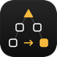

<div align="center">
  <h2 style="display: inline-flex; align-items: center; gap: 10px; margin: 0;">
    
    <p>&nbsp;&nbsp;&nbsp;&nbsp;Code-Automata ™ </p>
    <p></p>
  </h2>
</div>

<a href="https://youtu.be/jNYMC-HXDNA" target="_blank" rel="noopener noreferrer">
  
</a>

_"Ever since the first MVP was shipped, Code-Automata™ has started modifying its **own code**..."_ — It felt weird at first, but it is fun to watch it ship its own features one by one to production. That's the power of a clean workflow design!

---

> [!IMPORTANT]
> This branch is **Code-Automata 3.0**, a rewrite in progress: a Rust core and a Tauri desktop app replace the Electron app. There is no runnable desktop app on this branch yet. The last released version, 2.2.4, is on [`main`](https://github.com/danted4/Code-Automata/tree/main) and on the [releases page](https://github.com/danted4/Code-Automata/releases).

## What it is

Code-Automata runs AI coding agents (Claude Code, Cursor, Amp) through a five-column Kanban workflow. Each task gets its own git worktree and branch inside the project you open.

```
┌──────────┐    ┌─────────────┐    ┌───────────┐    ┌──────────────┐    ┌──────┐
│ Planning │ -> │ In Progress │ -> │ AI Review │ -> │ Human Review │ -> │ Done │
└──────────┘    └─────────────┘    └───────────┘    └──────────────┘    └──────┘
```

- **Planning:** an agent asks questions, writes a plan, and splits it into subtasks. You can review the plan or let it run straight through.
- **In Progress:** one agent run per subtask. Each finished subtask is committed as a checkpoint, with a handoff note for the next one.
- **AI Review:** your check commands (typecheck, build, lint) run first, then read-only QA agents. A failure sends the task back for up to two rework rounds.
- **Human Review:** open the worktree in your editor, then create a pull request; the checkpoints are squashed into one commit.

3.0 keeps every run's position on disk. Closing the app, a crash or Pause leaves the task where it was. Resume continues the same subtask, using the agent's own session and the partial work.

## Repository layout

| Path | What |
| --- | --- |
| `crates/core` | The Rust core (`ca_core`): task store, run engine, agent processes, git and worktrees |
| `ui/` | The React UI (Vite, React Router, Tailwind) |
| `docs/images/` | Screenshots and logos |

The Tauri shell (`crates/app`) and the HTTP server between the UI and the core are not built yet.

## Development

Requirements: Rust 1.89 or newer, Node 22 and Yarn 1, and Git.

```bash
# Rust core
cargo test
cargo clippy --all-targets -- -D warnings

# UI
cd ui
yarn install
yarn dev          # http://localhost:5173 (API calls fail until the HTTP server exists)
yarn lint && yarn typecheck && yarn test && yarn build
```

## License

AGPL-3.0-or-later. See [LICENSE](LICENSE).
