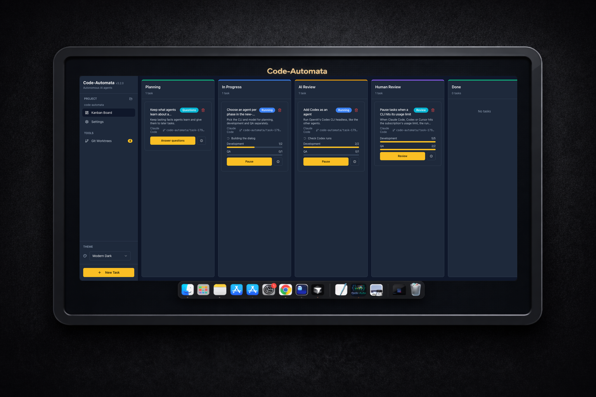
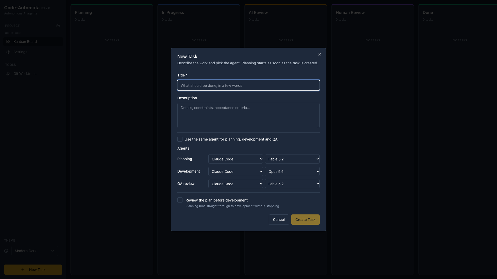
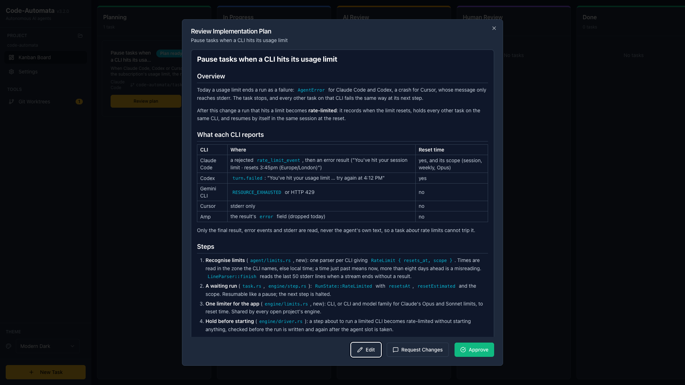
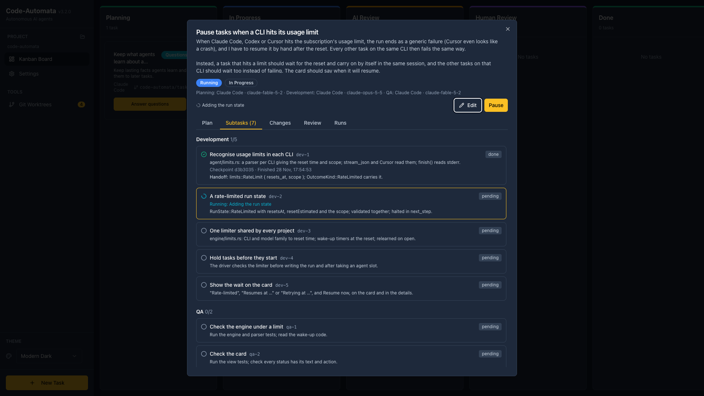
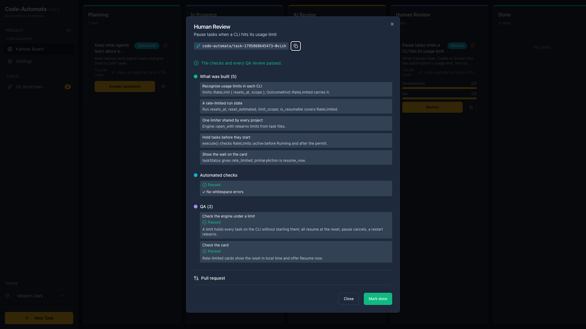
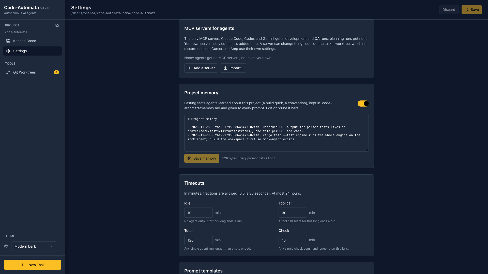
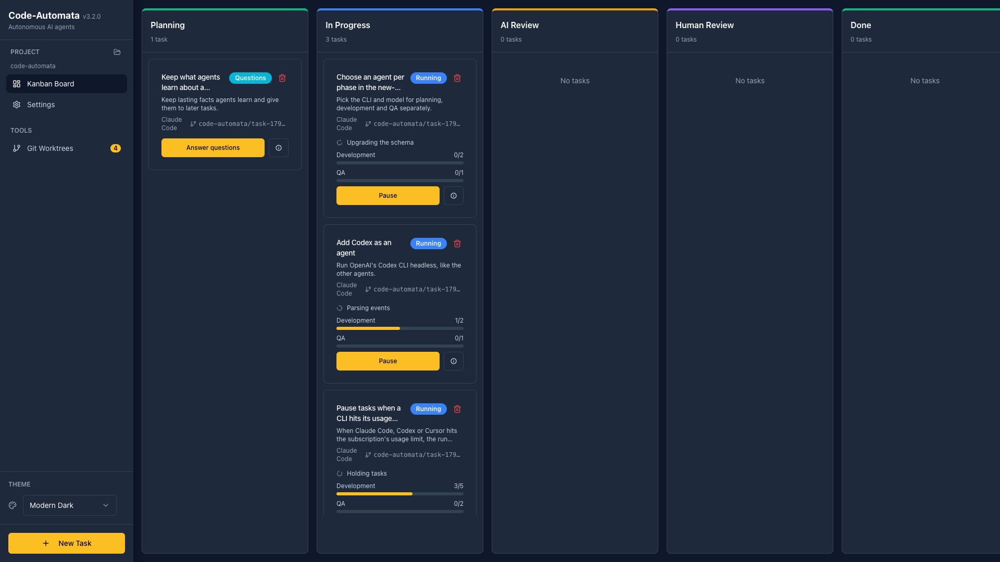

<div align="center">
  <h2 style="display: inline-flex; align-items: center; gap: 10px; margin: 0;">
    
    <p>&nbsp;&nbsp;&nbsp;&nbsp;Code-Automata ™ </p>
    <p></p>
  </h2>
</div>

<a href="https://youtu.be/jNYMC-HXDNA" target="_blank" rel="noopener noreferrer">
  
</a>

_"Ever since the first MVP was shipped, Code-Automata™ has started modifying its **own code**..."_ — It felt weird at first, but it is fun to watch it ship its own features one by one to production. That's the power of a clean workflow design!

---

> [!IMPORTANT]
> **Code-Automata 3.0** is a rewrite: a Rust core and a Tauri desktop app replace the Electron app of 2.x. It does not read 2.x task data. The last 2.x version, 2.2.4, stays on the [releases page](https://github.com/danted4/Code-Automata/releases) and its code on the [`main-backup`](https://github.com/danted4/Code-Automata/tree/main-backup) branch.

## Install

Download the installer for your platform from the [latest release](https://github.com/danted4/Code-Automata/releases/latest):

| Platform | File |
| --- | --- |
| macOS 11 or newer (Apple Silicon and Intel) | `Code-Automata-<version>-macos-universal.dmg` |
| Windows 10 or 11 | `Code-Automata-<version>-windows-x64-setup.exe` (installs for your user, no admin) |
| Linux | `Code-Automata-<version>-linux-x86_64.AppImage` or `-linux-amd64.deb` |

You also need Git and at least one agent CLI, logged in: Claude Code, Cursor's `agent` or Amp.

The installers are not code-signed, so the first launch needs one extra step:

- **macOS:** open the DMG and drag Code-Automata to Applications. The first time you open it, macOS refuses because it cannot verify the developer. Open System Settings → Privacy & Security and click **Open Anyway**.
- **Windows:** SmartScreen shows "Windows protected your PC". Click **More info**, then **Run anyway**.
- **Linux:** `chmod +x Code-Automata-*.AppImage` and run it, or `sudo apt install ./Code-Automata-*.deb`.

Check a download against `checksums.sha256` from the same release: `shasum -a 256 -c checksums.sha256 --ignore-missing`.

The app checks for a new version once at launch and asks before installing it. Updating restarts the app; tasks that were running stop where they are and continue with Resume. Only stable releases are offered: a pre-release (`3.0.0-rc.1`, say) is installed by hand and is offered the next stable version.

## What it is

Code-Automata runs AI coding agents (Claude Code, Codex, Cursor, Amp, and Gemini as experimental) through a five-column Kanban workflow, with an agent of your choice for each phase. Each task gets its own git worktree and branch inside the project you open.

```
┌──────────┐    ┌─────────────┐    ┌───────────┐    ┌──────────────┐    ┌──────┐
│ Planning │ -> │ In Progress │ -> │ AI Review │ -> │ Human Review │ -> │ Done │
└──────────┘    └─────────────┘    └───────────┘    └──────────────┘    └──────┘
```

- **Planning:** an agent asks questions, writes a plan, and splits it into subtasks. You can review the plan or let it run straight through.
- **In Progress:** one agent run per subtask. Each finished subtask is committed as a checkpoint, with a handoff note for the next one.
- **AI Review:** your check commands (typecheck, build, lint) run first, then read-only QA agents. A failure sends the task back for up to two rework rounds.
- **Human Review:** open the worktree in your editor, then create a pull request; the checkpoints are squashed into one commit.

3.0 keeps every run's position on disk. Closing the app, a crash or Pause leaves the task where it was. Resume continues the same subtask, using the agent's own session and the partial work.

## Screenshots

| | |
|---|---|
|  |  |
| A new task: an agent and model per phase | Reviewing the plan before development |
|  |  |
| A task's subtasks, changes and runs | Human review: what was built, checks, QA, pull request |
|  |  |
| Settings: MCP servers for agents and project memory | The board |

The screenshots and the video come from a scripted run of the app with its test agent (`yarn demo`).

## Things to know

- Agents work in a git worktree per task, and they can edit any file there, including your repository's git hooks (for example husky's `.husky/`). Code-Automata runs hooks as git normally does: `post-commit` and `prepare-commit-msg` on each checkpoint commit, `pre-push` when it creates or updates the pull request, with your login shell's `PATH`. Review hook changes in a task's diff before you push it.
- Pull requests: on GitHub they are opened with the [GitHub CLI](https://cli.github.com/) (`gh`, logged in); on GitLab, including self-hosted 11.10 or later, git opens the merge request itself with push options, no CLI needed. Any other host gets the branch pushed and keeps the link the host prints for opening a pull request. The host is detected from `origin`; set it under Settings → Pull requests when the address does not say (a self-hosted GitLab, say).
- A project is a git repository's root, or a **workspace**: a folder whose every (non-hidden) folder is a git repository. In a workspace one task can change several repositories, each in its own worktree, and gets one pull request per repository it changed. A folder inside a repository is not opened as that repository; open its root.
- Usage limits: a task whose CLI hit its subscription's limit waits ("Rate-limited, resumes at …") and starts again on its own; other tasks on that CLI wait with it.
- Agents get no MCP servers unless you list them under Settings → MCP servers for agents (development and QA runs only). What agents learn about a project is kept in `.code-automata/memory.md` and given to later tasks; edit or turn it off in Settings.
- Gemini (experimental): Google ended Gemini CLI's free sign-in for individuals; from the app it works with Vertex AI or a company Code Assist plan. Codex needs a ChatGPT plan. Runs leave out every CLI's API-key variable, so your subscriptions are used.
- The installers are not code-signed (see Install).

## Repository layout

| Path | What |
| --- | --- |
| `crates/core` | The Rust core (`ca_core`): task store, run engine, agent processes, git and worktrees |
| `crates/server` | The HTTP API and event stream the UI talks to (`ca_server`), and the `ca-server` binary |
| `crates/app` | The desktop app (Tauri 2): the UI in a window with the server in-process |
| `ui/` | The React UI (Vite, React Router, Tailwind), with its end-to-end scenarios in `ui/e2e/` |
| `docs/images/` | Screenshots and logos |

## Development

Requirements: Rust 1.89 or newer, Node 22 and Yarn 1, and Git; on Linux, the webview development files (`libwebkit2gtk-4.1-dev`). Agents: Claude Code, Cursor's `agent` CLI or Amp, logged in.

```bash
# Rust
cargo test
cargo clippy --all-targets -- -D warnings

# The desktop app (Tauri CLI: cargo install tauri-cli --version "^2.12" --locked)
cd ui && yarn install && cd ../crates/app && cargo tauri dev

# Or the app in a browser
cargo run -p code-automata-server --bin ca-server -- --port 7878 --token dev
cd ui && yarn install && yarn dev        # http://localhost:5173

# UI checks
cd ui && yarn lint && yarn typecheck && yarn test && yarn build

# End-to-end scenarios (agent-browser, mock agent)
cargo build && cd ui && yarn build && yarn e2e
```

## License

MIT. See [LICENSE](LICENSE).
